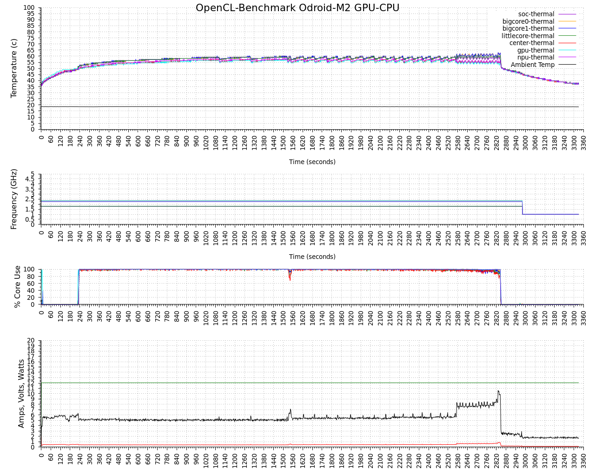

# logenv

## Introduction
logenv classic is a Linux command-line utility for the aggregating, logging, and charting of timestamped CPU core frequencies, thermal zone temperatures, ambient temperature, CPU core usage, memory usage, sensors data and volts, amps and watts, from a HardKernel SmartPower2 or SmartPower3, as a single-shot or continuos interval based feed.  Many sensors are supported and logenv can also generate GNUplot scripts for any collected data set, as well as provide a UDP network stream.



License: GPLv3.


### Build
```
  git clone https://github.com/hominoids/logenv.git
  cd logenv
  make
```

## Usage
```
usage: logenv [options]

Options:
        -l,  --log <file>            Log to <file>
        -i,  --milliseconds <number> Polling Interval <number> in milliseconds
        -d,  --date                  Date and Time stamp
        -f,  --frequency             CPU core frequency
        -t,  --temperature           Thermal zone temperature
        -u,  --usage                 CPU core usage, aggregate and core 0 to core n-1
        -m,  --memory                Physical memory usage (total - available, see man free)
        -p,  --smartpower3-ch1 <tty> Volt, Amp, Watt (HK SmartPower3 USBC port), default /dev/ttyUSB0
             --smartpower3-ch2 <tty>
             --smartpower2 <tty>     Volt, Amp, Watt (HK SmartPower2 microUSB port), default /dev/ttyUSB0
        -a   <sensor>                Ambient Temperature sensor to use (e.g. --bme280) for Thermal chart
             --mcp9808 <device>      High Accuracy Temperature Sensor I2C 0x18 default /dev/i2c-0
             --sht4x <device>        Temperature and Humidity I2C 0x44 default /dev/i2c-0
             --shtc3 <device>        Temperature and Humidity I2C 0x70 default /dev/i2c-0
             --aht20 <device>        Temperature and Humidity I2C 0x70 default /dev/i2c-0
             --htu31d <device>       Temperature and Humidity I2C 0x40 default /dev/i2c-0
             --bme280 <device>@addr  Temperature, Humidity, Pressure Sensor I2C 0x76 or 0x77 default /dev/i2c-0@0x76
             --bme680 <device>       Temperature, Humidity, Pressure & VOC Sensor I2C 0x76 or 0x77 default /dev/i2c-0@0x77
             --bmp180 <device>       Barometric Pressure, Altitude & Temperature Sensor default /dev/i2c-0
             --bmp388 <device>       Barometric Pressure, Altitude & Temperature Sensor I2C 0x76 or 0x77 default /dev/i2c-0@0x77
             --bmp390 <device>       Barometric Pressure, Altitude & Temperature Sensor I2C 0x76 or 0x77 default /dev/i2c-0@0x77
             --sgp30 <device>        VOC and eCO2 Sensor I2C 0x58 default /dev/i2c-0
             --scd30 <device>        CO2 Temperature and Humidity Sensor I2C 0x61 default /dev/i2c-0
             --scd40 <device>        CO2 Temperature and Humidity Sensor I2C 0x62 default /dev/i2c-0
             --scd41 <device>        CO2 Temperature and Humidity Sensor I2C 0x62 default /dev/i2c-0
             --scd43 <device>        CO2 Temperature and Humidity Sensor I2C 0x62 default /dev/i2c-0
             --pmsa003i <device>     Particle Sensor PM1.0, PM2.5, PM10.0 I2C 0x12 default /dev/i2c-0
        -r,  --raw                   Raw output, no formatting of freq. or temp.  e.g. 35000 instead of 35
        -q,  --quiet                 No output to stdout
        -v,  --verbose               Readable dashboard output
        -n,  --udp <host>:<port>     UDP output to <host>:<port>
        -g,  --gnuplot <file>        Gnuplot script generation
             --title <string>        Chart title <string>
             --xmtics <number>       Chart x-axis major second tics <number>
             --version               Version
        -h,  --help                  Help screen
```


## Example
This example is a typical data collection and charting workflow:

Every 2 seconds collect the CPU frequency, thermal zone temperatures, CPU usage, SmartPower3 Volt, Amp and Watts, and mcp9808 as ambient temperature. 
```
./logenv -l ocl-m2_g610-a76_1.csv -i 2000 -f -t -a --mcp9808 -u -p
```

Generate the GNUplot script
```
./logenv -g ocl-m2_g610-a76_1.gpl --title "OpenCL-Benchmark Odroid-M2 GPU-CPU" --xmtics 60 -i -f -t -a --mcp9808 -u -p
```

Generate the chart
```
gnuplot -c ocl-m2_g610-a76_1.gpl ocl-m2_g610-a76_1.png ocl-m2_g610-a76_1.csv
```


## SmartPower Settings
Settings for the Hard Kernel SmartPower3 and SmartPower2 are baud rate 115200,8N1 with no HW or SW control.

## Builtin Sensor Support
Many types of sensors are directly supported using built in drivers and require no other setup.  At this time only I2C access is available for those that also have a SPI interface.  The I2C device and or the address can follow any sensor argument while using the command line interface, otherwise the default values are used.  The I2C address follows standard C language notation for decimal, hex or octal e.g. 119, 0x77, 0167 
```
logenv --bme680
       --bme680 /dev/i2c-0
       --bme680 /dev/i2c-0@119.
       --bme680 /dev/i2c-0@0x77.
       --bme680 /dev/i2c-0@0167.
```

```
aht20 - Temperature & Humidity I2C ADD 0x38
htu31 - Temperature & Humidity I2C ADD 0x40
sht40,sht41,sht43,sht45 - Temperature & Humidity I2C ADD 0x44
shtC3 - Temperature & Humidity I2C ADD 0x70
mcp9808 - High Accuracy Temperature Sensor I2C ADD 0x18

bme280 - Pressure, Altitude, Temperature & Relative Humidity, ADD 0x76 or 0x77
bme680 - Pressure, Altitude, Temperature, Relative Humidity & VOC ADD 0x76 or 0x77

bmp180 - Barometric Pressure, Altitude and Temperature
bmp388 - Barometric Pressure, Altimeter and Temperature I2C ADD 0x76 or 0x77
bmp390 - Barometric Pressure, Altimeter and Temperature I2C ADD 0x76 or 0x77

sgp30 - VOC and eCO2 I2C ADD 0x58

scd30 - NDIR True CO2 (400ppm – 10,000ppm), Temperature and Humidity Sensor ADD 0x61
scd40,scd41,scd43 - True CO2, Temperature and Humidity Sensor ADD 0x62

pmsa003i - Particles PM1.0, PM2.5, PM10.0 ug/m^3 I2C ADD 0x12
```

## GNUPlot Charts
Single or stacked charts are created based on the type and number of datum that are contained in the data set.  Core Frequency, Thermal Zone Temperatures, Ambient Temperature, CPU core usage, memory usage, SmartPower and sensor data can all be charted.  When a GNUPlot Script file is generated, part of it's contents is based on the number of CPU cores and the number and name of thermal Zones.  For this reason the GNUPlot script needs to be generated on the machine the data was collected from if any of those datum are included.  The GNUPlot Scripts or .gpl files can be reused and don't need to be regenerated if the type of data being collected and the machine are the same.

## UDP Client
The UDP client -n option is followed by the server host and port <host:port>. The host entry can be either an IP address or host name.  Make sure the port is open if using a firewall.  From the command-line on the server host system, netcat can be used to read the UDP feed.

```
netcat -l -u -p <port>
```

## Timing accuracy
The timing accuracy for both the logging and display functions are dependant on the number and type of data being collected.  Some sensors can inject significant latency due to the time it takes for readings.  This is especially true for those sensors that require heaters, e.g. MOX sensors, or other pre-read initialization process.  If the logging, UDP or display functions are simultaneously being used, they share the same data read for each interval which reduces the number of sensor and data reads, and thereby reducing latency.
 
## Compatibility
logenv has been tested with both a HardKernel SmartPower2 and SmartPower3, including MCP9808 and BME280 sensors.  Several architectures have been test including Armv7, Armv8, Armv9 and different generations of INTEL and AMD processor up to 32 cores.  The current limitation is 256 cores.  It has also been used on several Linux distributions including Ubuntu, Debian, Manjaro and Arch.  It should run on just about anything that runs Linux.
